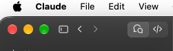
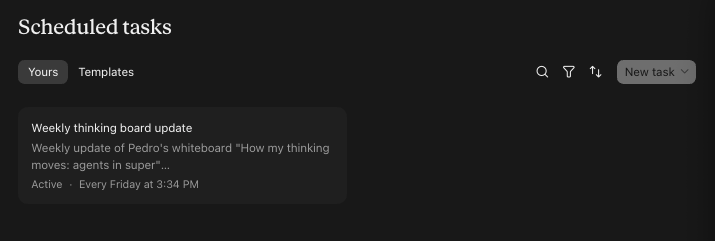
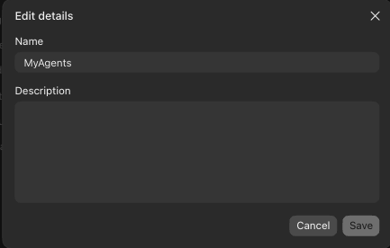
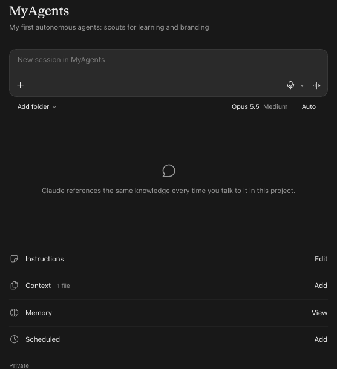
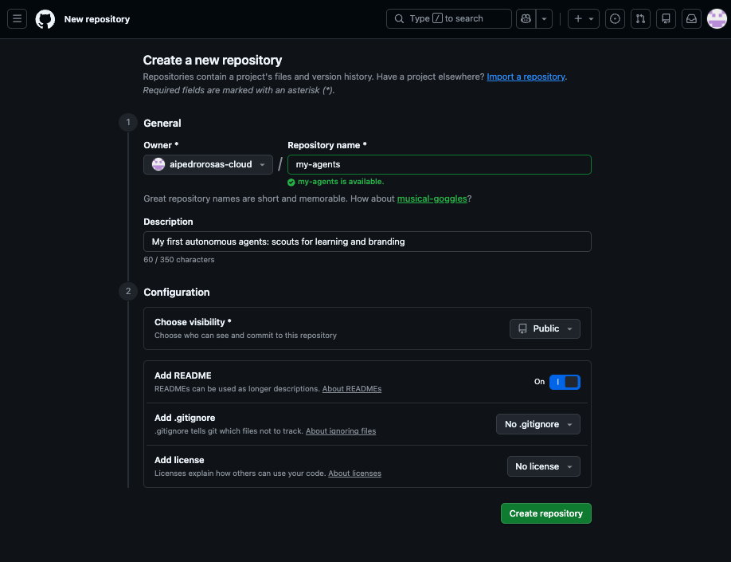
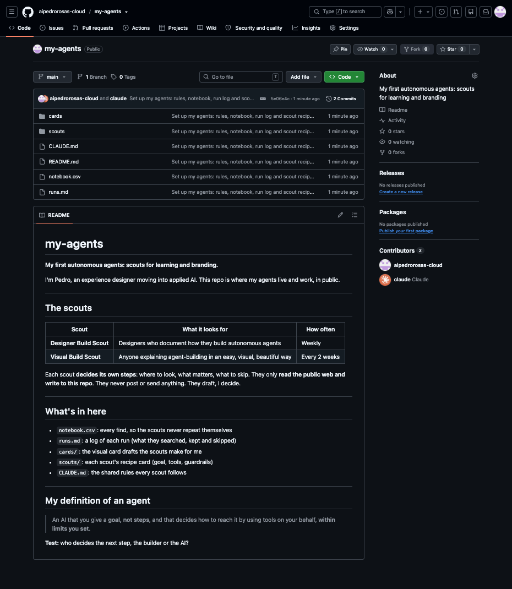
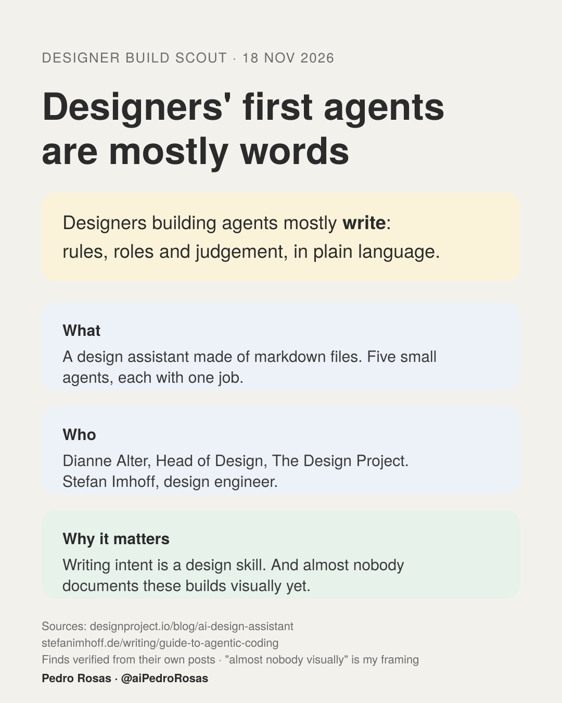

# The story: building my first autonomous agents

A visual diary of the build. One folder per day, screenshots in order.

---

## Day 1 · 18 Nov 2026 · From idea to first run

| # | Moment | Screenshot |
|---|---|---|
| 1 | Claude Desktop already on my Mac |  |
| 2 | Found "Scheduled": where agents will live |  |
| 3 | Naming the project: MyAgents |  |
| 4 | Project ready, with my rules and context |  |
| 5 | Creating my first public GitHub repo |  |
| 6 | The repo is live: me + Claude as contributors |  |
| 7 | The scout's first visual card |  |

**What happened, in one line:** an idea in the morning, a working agent by lunch: rules, memory, tools and a first visual card.
